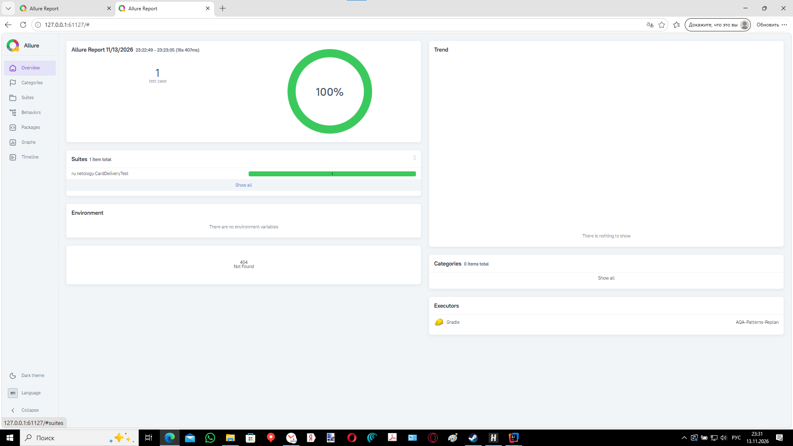
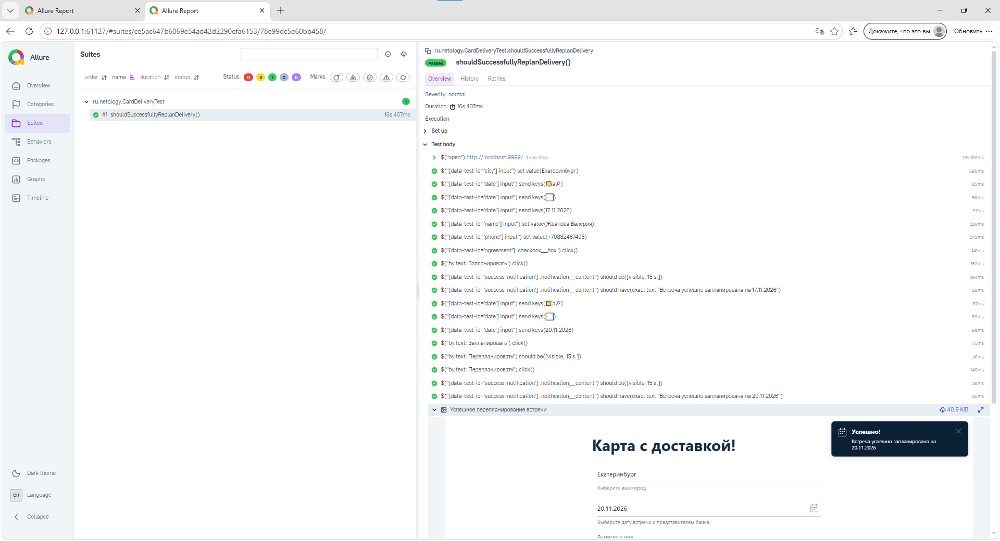

# Домашнее задание «2.3. Patterns»

## Задача № 1. Заказ доставки карты (изменение даты)


### Описание проекта

Автоматизированное тестирование формы заказа доставки банковской карты с возможностью перепланирования встречи.

### Используемые технологии

- Java 17
- Gradle
- JUnit 5
- Selenide
- Java Faker
- Lombok
- GitHub Actions
- Allure Report

### Реализованный сценарий

1. Генерация тестовых данных клиента.
2. Первоначальное бронирование встречи.
3. Проверка успешного бронирования.
4. Изменение даты встречи с сохранением остальных данных.
5. Повторная отправка формы.
6. Подтверждение перепланирования.
7. Проверка успешного изменения даты встречи.

### Запуск приложения

```bash
java -jar ./artifacts/app-replan-delivery.jar
```

Приложение доступно по адресу:

http://localhost:9999

### Запуск автотестов

Windows:

```powershell
.\gradlew.bat test "-Dselenide.headless=true" --info
```

Linux:

```bash
bash ./gradlew test --info -Dselenide.headless=true
```

### Результаты

Автотесты успешно выполнены локально и в GitHub Actions.

---

# Домашнее задание «4.1. Репортинг»

## Задача № 1. Проснулись (Allure)

### Описание задания

В существующий проект автоматизированного тестирования доставки банковской карты интегрирован Allure Report.

Интеграция позволяет формировать наглядные отчёты о выполнении автотестов на Selenide, просматривать последовательность действий и анализировать результаты проверок.

### Реализованные возможности

- Интеграция Allure с JUnit 5 и Selenide.
- Автоматическая запись шагов Selenide.
- Отображение статуса и продолжительности выполнения теста.
- Прикрепление скриншотов при ошибках.
- Сохранение HTML-кода страницы при ошибках.
- Прикрепление скриншота успешного перепланирования встречи.

### Запуск тестов с Allure

Перед запуском тестов необходимо запустить приложение:

```bash
java -jar ./artifacts/app-replan-delivery.jar
```

В отдельном терминале запустить автотесты.

Windows:

```powershell
.\gradlew.bat test "-Dselenide.headless=true" --info
```

Linux:

```bash
bash ./gradlew test --info -Dselenide.headless=true
```

### Формирование и просмотр отчёта

После выполнения автотестов запустить Allure:

Windows:

```powershell
.\gradlew.bat allureServe
```

Linux:

```bash
bash ./gradlew allureServe
```

После выполнения команды запускается локальный сервер Allure, а отчёт становится доступен в браузере.

Для остановки сервера используется сочетание Ctrl + C в терминале.

### Результаты тестирования

Автотест перепланирования встречи успешно выполнен.

- Всего тестов: 1.
- Успешных тестов: 1.
- Ошибок: 0.
- Успешность: 100%.

В отчёте отображаются действия Selenide, проверки планирования и перепланирования встречи, а также скриншот итогового уведомления.

### Скриншоты Allure Report

#### 1. Общий результат тестирования

На главной странице Allure отображается результат выполнения автотеста — 100% успешности.



#### 2. Подробности теста и прикреплённый скриншот

В разделе Suites отображаются шаги выполнения теста, проверки дат и вложение со скриншотом успешного перепланирования встречи.



### Итог

Allure успешно интегрирован с Selenide. Отчёт генерируется при локальном запуске тестов, содержит подробные шаги и позволяет просматривать прикреплённые изображения.
